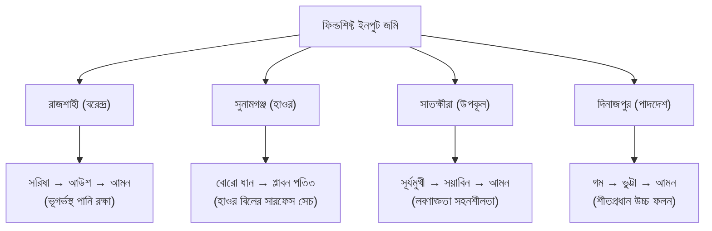

# FieldShift — User Guide & Operator Manual
## ব্যবহারকারী নির্দেশিকা ও পরিচালন নির্দেশিকা (বাংলা ও English)
**NASA Space Apps Challenge 2026 — "Field Shift: Adapting Farms with NASA Data"**

---

## ১. ভূমিকা / Introduction

### বাংলা
**FieldShift** হলো একটি বাস্তবসম্মত ও স্বচ্ছ জলবায়ু-অভিযোজনমূলক কৃষি সিদ্ধান্ত প্ল্যাটফর্ম। এটি নাসার দীর্ঘ ২৫ বছরের উপগ্রহ উপাত্ত (NASA POWER, GPM IMERG, SMAP, GRACE) এবং মাটির আন্তর্জাতিক উপাত্ত (ISRIC SoilGrids) ব্যবহার করে বাংলাদেশের প্রতিটি কৃষি পরিবেশিক অঞ্চলের জন্য লাভজনক, পানি-সাশ্রয়ী ও ঝুঁকি-মুক্ত শস্য আবর্তন পরিকল্পনা তৈরি করে।

### English
**FieldShift** is an open-science agricultural adaptation platform designed for Bangladeshi farmers, extension agents (SAAO), and agronomists. Driven by 25 years of NASA Earth observations (POWER, GPM IMERG, SMAP, GRACE) and ISRIC SoilGrids, it converts complex climate telemetry into honest, actionable, multi-season crop rotation plans that conserve groundwater and maximize farm income.

---

## ২. দ্রুত শুরু / Quick Start (3-Step Farmer Flow)

### ধাপ ১: জমি নির্বাচন বা যুক্ত করা (Step 1: Select or Add Field)
1. স্ক্রিনের উপরের ড্রপডাউন বা **"আমার জমি" (My Fields)** পেজ থেকে আপনার কাঙ্ক্ষিত জেলা বা প্লট নির্বাচন করুন।
2. নতুন জমি যুক্ত করতে জিপিএস অক্ষাংশ ও দ্রাঘিমাংশ প্রদান করুন। ফিল্ডশিফ্ট তাৎক্ষণিকভাবে ISRIC SoilGrids থেকে মাটির ধরন (বেলে, পলি, দোআঁশ, এঁটেল) এবং নাসার নিকটস্থ ০.৫° গ্রিড সেল যুক্ত করে নেবে।

### ধাপ ২: সিদ্ধান্ত বাক্য ও প্রধান কেপিআই (Step 2: Read Advice & KPIs)
প্রতিটি পেজের শুরুতে একটি সুনির্দিষ্ট **সিদ্ধান্ত বাক্য (Answer-First Header)** এবং ৩টি মূল কেপিআই প্রদর্শিত হয়:
- **সম্ভাব্য অতিরিক্ত লাভ (৳/হেক্টর বা ৳/বিঘা)**
- **সেচ পানির সাশ্রয় (মিমি)**
- **মাটির নাইট্রোজেন ও উর্বরতা বৃদ্ধি (কেজি N/হেক্টর)**

### ধাপ ৩: প্রিন্ট ও এসএমএস (Step 3: Print Card / Copy SMS)
- **"রিপোর্ট ডাউনলোড / প্রিন্ট" (Print Farmer Card)**: এক ক্লিকে পরিষ্কার A4 ফরম্যাটে পুরো বছরের ফসল ক্যালেন্ডার ও সার প্রয়োগ নির্দেশিকা প্রিন্ট করুন।
- **"SMS কপি করুন" (Copy SMS)**: ইন্টারনেট বিহীন সাধারণ বাটন ফোনে কৃষকদের পরামর্শ পাঠাতে সংক্ষিপ্ত বাংলা এসএমএস টেক্সট ক্লিপবোর্ডে কপি করুন।

---

## ৩. প্ল্যাটফর্মের ৮টি প্রধান মডিউল / 8 Core Platform Modules

| ক্রম | পেজের নাম | বর্ণনা ও কাজ | ব্যবহৃত উপাত্ত সূত্র |
| :---: | :--- | :--- | :--- |
| **১** | **হোম (Overview)** | আজকের সারসংক্ষেপ, প্রধান সিদ্ধান্ত, ৩০ দিনের বৃষ্টিপাত এবং অনসেট পরিবর্তন। | NASA POWER, IMERG |
| **২** | **আমার জমি (My Fields)** | খামার প্লট রেজিস্ট্রি, মাটির গঠন, জিপিএস অবস্থান ও সেচ সক্ষমতা। | ISRIC SoilGrids, SRTM |
| **৩** | **আবর্তন পরিকল্পনা (Rotation Planner)** | প্রচলিত ফসলের বনাম ৩টি বিকল্প অপটিমাইজেশন কৌশল ও ১২ মাসের ক্যালেন্ডার। | FAOSTAT, BBS, FAO-56 |
| **৪** | **আবহাওয়া ও ঝুঁকি (Climate & Risk)** | প্রাক-বর্ষা ও আমন অনসেট শিফট, তাপপ্রবাহ ঝুঁকি এবং ৬৪ জেলার ক্লাইমেট ম্যাপ। | NASA POWER, IMERG, GRACE |
| **৫** | **পানি ও সেচ (Water & Irrigation)** | সেচ ক্যালেন্ডার, এডব্লিউডি (AWD) শিডিউল এবং ত্রিমাত্রিক মাটির পানির স্তম্ভ। | FAO-56, NASA SMAP L4 |
| **৬** | **বাজার ও লাভ (Market & Profit)** | বাজারদর পূর্বাভাস, উৎপাদন খরচ, মোট লাভ ও জাতীয় খাদ্য পুষ্টি চাহিদা। | BBS Agri Stats, FAO |
| **৭** | **৩ডি খামার (3D Farm Diorama)** | বাস্তবসম্মত ত্রিমাত্রিক আইসোমেট্রিক খামার মডেল, ফসলের বৃদ্ধি ও পানির অ্যানিমেশন। | Three.js WebGL Engine |
| **৮** | **প্রমাণ ও পদ্ধতি (Evidence & Method)** | নাসার উপগ্রহ উপাত্তের প্রমাণপত্র, গবেষণা কোড এবং বিচারক চেকলিস্ট। | NASA Earthdata Provenance |

---

## ৪. আঞ্চলিক অভিযোজন ও ৪টি পরীক্ষামূলক অঞ্চল / Regional Divergence

বাংলাদেশের প্রধান ৪টি কৃষি পরিবেশিক অঞ্চলে মাটির গঠন ও জলবায়ু অনুযায়ী ফিল্ডশিফ্ট কীভাবে সম্পূর্ণ ভিন্ন এবং যৌক্তিক সিদ্ধান্ত প্রদান করে:

1. **রাজশাহী (বরেন্দ্র অঞ্চল — Barind Terrace):**
   - *সমস্যা:* ভূগর্ভস্থ পানির স্তর প্রতি বছর ১.০৭ সেমি হ্রাস পাচ্ছে (NASA GRACE-FO যাচাইকৃত) এবং মাটি এঁটেল দোআঁশ।
   - *সমাধান:* অধিক পানিশোষী বোরো ধান কমিয়ে রবি মৌসুমে কম পানির সরিষা ও ডালশস্য নির্বাচন।
2. **সুনামগঞ্জ (হাওর অববাহিকা — Haor Basin):**
   - *সমস্যা:* বর্ষাকালে ৩-৪ মিটার গভীর আকস্মিক বন্যা থাকে, ফলে খরিফ-২ তে ফসল চাষ অসম্ভব।
   - *সমাধান:* খরিফ মৌসুমে প্লাবন-পতিত রাখা এবং শীতকালে শুকিয়ে যাওয়া বিল-নদীর ১২০০ মিমি সহজলভ্য সারফেস পানি দিয়ে লাভজনক উচ্চ-ফলনশীল বোরো ধান চাষ।
3. **সাতক্ষীরা (উপকূলীয় অঞ্চল — Coastal Belt):**
   - *সমস্যা:* শুষ্ক মৌসুমে জোয়ারের লোনা পানিতে মাটির লবণাক্ততা ৪-১২ dS/m পর্যন্ত বৃদ্ধি পায় যা ডালশস্যের জন্য মারাত্মক ক্ষতিকর।
   - *সমাধান:* লবণ-সহনশীল সূর্যমুখী ও সয়াবিন আবর্তন নির্বাচন।
4. **দিনাজপুর (উত্তরাঞ্চলীয় পাদদেশ — Old Himalayan Piedmont Plain):**
   - *সমস্যা:* দীর্ঘ ও তীব্র শীতকাল।
   - *সমাধান:* শীতকালীন উচ্চ-ফলনশীল গম, ভুট্টা এবং আমন আবর্তন।

---

## ৫. ৩ডি খামার ও মাটির পানির স্তম্ভ / Purposeful 3D Diorama & Soil Column

*চিত্র ১: নাসা স্পেস অ্যাপস বিচারক রুব্রিক ও উপাত্তের প্রমাণপত্র ভিউ*

*চিত্র ২: সেচ ক্যালেন্ডার ও ত্রিমাত্রিক মাটির পানির স্তম্ভ (বৃষ্টি ও বাষ্পীভবন কণা সহ)*

### ৩ডি খামারের নিয়ন্ত্রণ (3D Farm Controls):
- **মৌসুম স্লাইডার (Season Slider 0..5):** স্লাইডার ঘুরিয়ে ৬টি পৃথক মৌসুমে ফসলের বিস্তার, খাল ও পানির স্তর এবং মাটির আর্দ্রতা পরিবর্তন পর্যবেক্ষণ করুন।
- **ক্যামেরা ভিউ (Camera Presets):**
  - *সার্বিক দৃশ্য (Overview):* পুরো খামারের আইসোমেট্রিক ডায়োরামা রূপ।
  - *ক্লোজ-আপ (Close-up):* নির্দিষ্ট বেড বা খাঁদের শস্য সারি ও গাছ।
  - *মাটির পার্শ্ব-ছেদ (Side Cut):* মাটির নিচের ভৌগোলিক স্ট্র্যাটিগ্রাফি স্তর।
  - *টপ-ডাউন (Top-Down):* প্লটের ২ডি মানচিত্র সদৃশ ভিউ।

---

## ৬. নাসার উপাত্তের সততা ও পরিমাপের ভিত্তি / NASA Data Honesty Policy

> [!IMPORTANT]
> **কাল্পনিক সংখ্যা পরিহার নীতি (No Fabricated Data Rule):** ফিল্ডশিফ্টে কোনো কাল্পনিক বা হার্ডকোডেড উপগ্রহ মান প্রদর্শিত হয় না।
> - **NASA POWER:** দৈনিক সৌর বিকিরণ, তাপমাত্রা ও বাষ্পীভবন (ET0)।
> - **NASA GPM IMERG:** উচ্চ-রেজোলিউশনের (০.১°) দৈনিক বৃষ্টিপাত ও আমন অনসেট শিফট।
> - **NASA SMAP:** এল-ব্যান্ড রেডিওমিটার ভিত্তিক রুট-জোন মৃত্তিকা আর্দ্রতা (০-১০০ সেমি)।
> - **NASA GRACE-FO:** মাসকন গ্র্যাভিটেশনাল উপাত্ত ভিত্তিক ভূগর্ভস্থ পানির সঞ্চয় পরিবর্তন।
> - **মডেলের অনুমানসমূহ (Assumptions):** বাজারের ফসল মূল্য ও সারের খরচের পাশে একটি ছোট **"উদাহরণমূলক"** ট্যাগ থাকে যাতে কৃষক ও বিচারক বিভ্রান্ত না হন।

---

## ৭. সহায়তা ও যোগাযোগ / Help & SAAO Verification Notice

সব পরামর্শই বাস্তব উপগ্রহ তথ্যের ভিত্তিতে তৈরি, তবুও বীজ বোনা বা সার প্রয়োগের চূড়ান্ত সিদ্ধান্তের আগে আপনার এলাকার **উপ-সহকারী কৃষি কর্মকর্তা (SAAO / DAE)** এর সাথে সরাসরি যাচাই করার অনুরোধ করা হচ্ছে।

যেকোনো পেজে উপরের ডানদিকের **"?"** বাটনে ক্লিক করলে সেই পেজের নির্দিষ্ট নির্দেশিকা ও নাসার উপাত্ত সূত্র সাথে সাথে স্ক্রিনে প্রদর্শিত হবে।
